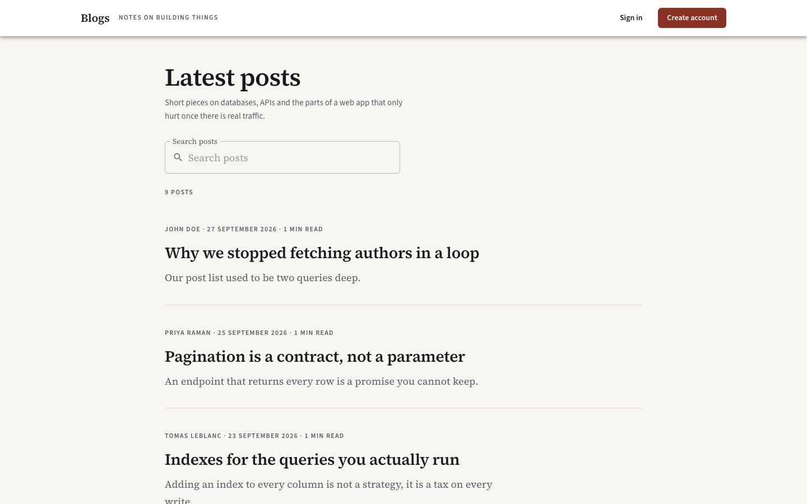

# Blogs

A small blogging app split into two npm workspaces: an Express + Prisma API in `server/` and a React client in `web/`. Anyone can read posts; you need an account to write, edit or delete them. Each post gets a short excerpt and a reading time when it's saved.



**Server:** Express, TypeScript, Prisma, PostgreSQL, JWT, bcrypt
**Web:** React 18, Vite, MUI, Formik + Yup, axios

## Features

- Sign up / log in with JWT (sent as an `authtoken` header or a Bearer token)
- Create, edit and delete your own posts (other users get a 403)
- Paginated post list with search on title and body, and a filter by author
- Excerpts generated on save. The default is a simple local extractor; setting `SUMMARY_PROVIDER=anthropic` with an `ANTHROPIC_API_KEY` uses the Anthropic API instead and falls back to the local one on errors.
- `GET /api/health` checks the database connection

## Getting started

You need Node 20+ and a Postgres database.

```bash
npm install
cp server/.env.sample server/.env    # set DATABASE_URL and JWT_SECRET
cp web/.env.sample web/.env
npm run setup                        # prisma generate, migrate, seed
npm run dev                          # runs API and web together
```

The API runs at http://localhost:7231/api and the client at http://localhost:7232.

The seed creates three users and nine posts. All seeded accounts use the password `blogs-demo-2024` (or whatever you set in `SEED_PASSWORD`), for example `johndoe@example.com`.

### Docker

```bash
cp server/.env.sample server/.env
docker compose up --build
docker compose --profile seed run --rm seed
```

This starts Postgres (port 7233), runs migrations, and starts the API (7231) and web client (7232).

## API

| Method | Path | Auth |
| --- | --- | --- |
| POST | `/api/auth/signup` | no |
| POST | `/api/auth/login` | no |
| GET | `/api/auth/me` | yes |
| GET | `/api/posts?search=&author=&page=&pageSize=` | no |
| GET | `/api/posts/:id` | no |
| POST | `/api/posts` | yes |
| PUT | `/api/posts/:id` | owner only |
| DELETE | `/api/posts/:id` | owner only |

Responses are wrapped as `{ "payload": ... }`. `pageSize` is capped at 50.

## Tests

```bash
npm test                               # both packages
npm run test:unit -w @blogs/server     # no database needed
npm run test:api -w @blogs/server      # needs Postgres
npm test -w @blogs/web
```

The API tests use `TEST_DATABASE_URL` (or `DATABASE_URL` if that isn't set) and leave data behind, so use a throwaway database.

## Next steps

- Search uses `ILIKE`, which is fine for a small dataset but would need a trigram index later.
- Tokens last 12 hours and there are no refresh tokens.
- No comments, tags or drafts yet.
